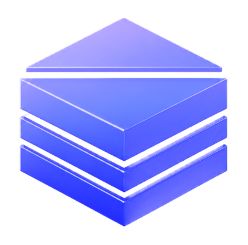
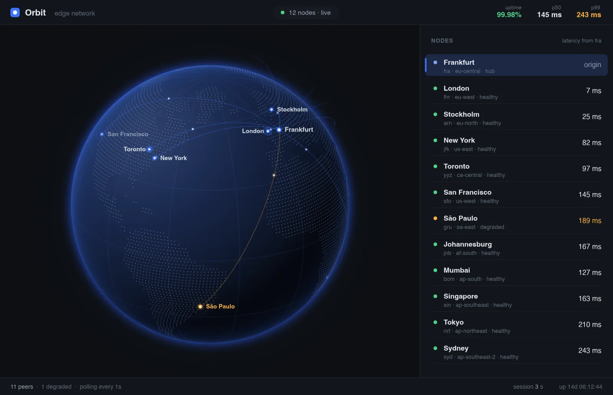
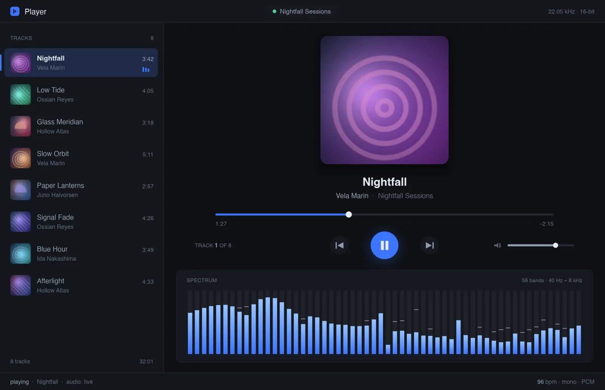
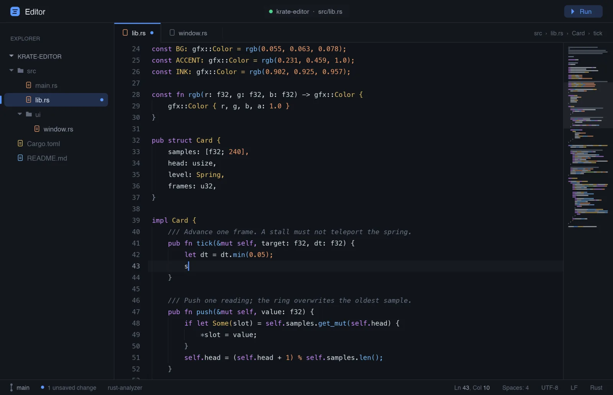
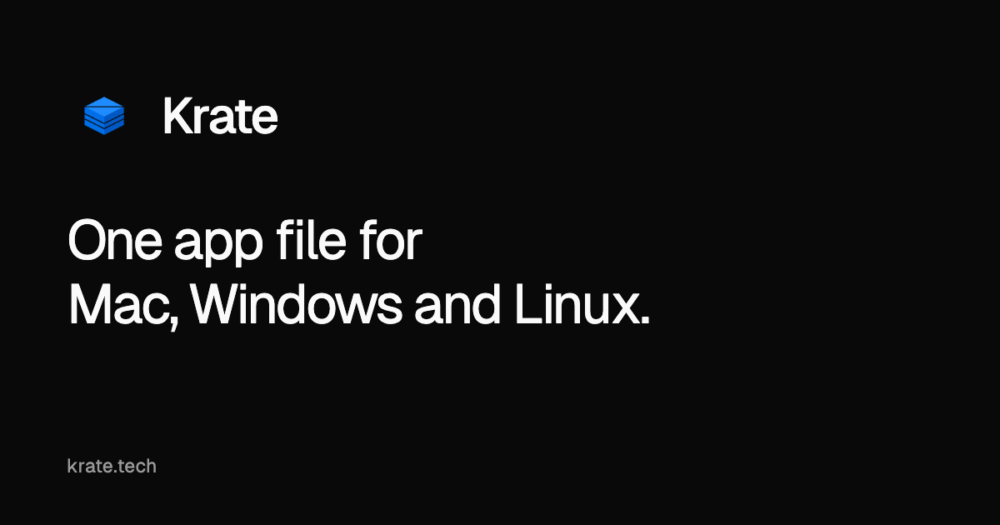
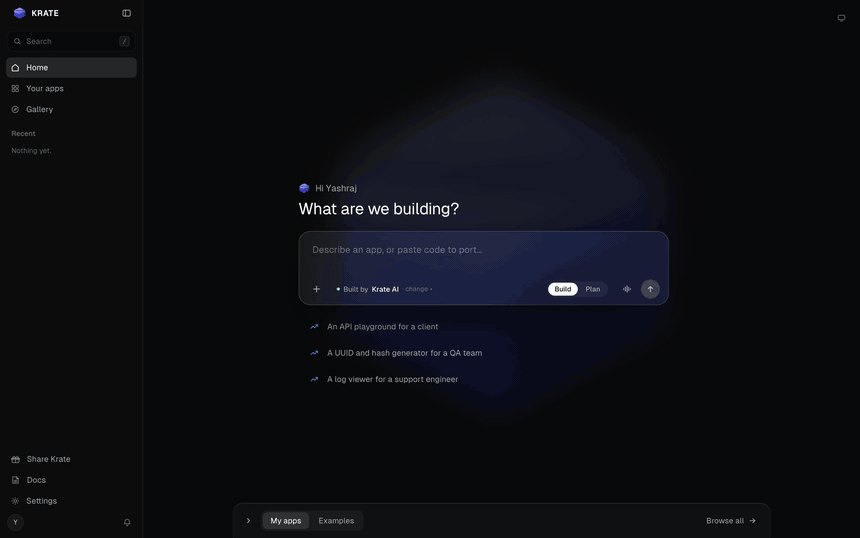
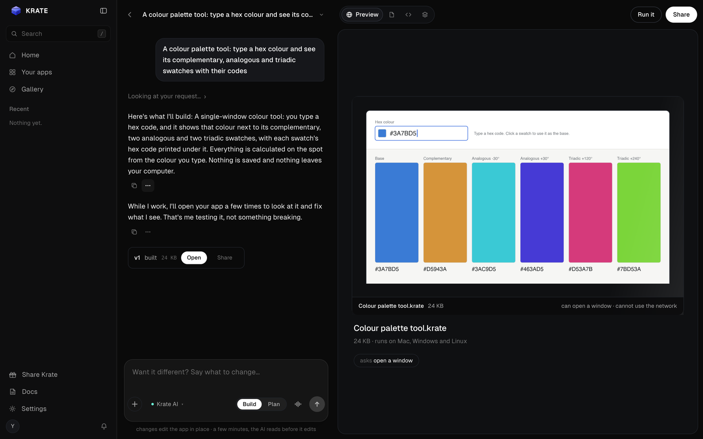

<p align="center">
  
</p>

<h1 align="center">Krate</h1>

<p align="center">
  <strong>Ship a desktop app as one file that opens natively on macOS, Windows and Linux.</strong>
</p>

<p align="center">
  Write the app in Rust, build it into a WebAssembly component, and send one <code>.krate</code>.<br>
  The runtime is open source, runs on Wasmtime, and is installed once per machine.<br>
  The same bytes open on all three systems, and an app can reach only what its manifest declares.
</p>

<p align="center">
  <a href="https://github.com/incyashraj/krate/actions/workflows/ci.yml">
    
  </a>
  <a href="https://github.com/incyashraj/krate/releases/latest">
    
  </a>
  <a href="LICENSE-MIT">
    
  </a>
</p>

<p align="center">
  <a href="https://github.com/incyashraj/krate-app-template"><b>Start from the template</b></a>
  ·
  <a href="https://krate.tech/docs/quickstart.html">Quickstart</a>
  ·
  <a href="https://krate.tech/docs/">Docs</a>
  ·
  <a href="https://github.com/incyashraj/krate/releases">Releases</a>
  ·
  <a href="https://github.com/incyashraj/krate/discussions">Discussions</a>
</p>

<table align="center">
  <tr>
    <td align="center"><br><sub><b>Orbit</b> · network globe</sub></td>
    <td align="center"><br><sub><b>Aurora</b> · simulation</sub></td>
  </tr>
  <tr>
    <td align="center"><br><sub><b>Player</b> · music player</sub></td>
    <td align="center"><br><sub><b>Editor</b> · code editor</sub></td>
  </tr>
</table>
<p align="center"><sub>Each is one <code>.krate</code> file built with Krate, with its source in <a href="apps/">apps/</a>. See them running at <a href="https://krate.tech/#made">krate.tech</a>.</sub></p>

## In numbers

The same 50,000-line notes workload on the same Apple M4 Mac, against
MarkText 0.17.1, an Electron editor. Both ARM64, measured 25 August 2026.

| | MarkText (Electron) | Krate |
|---|---:|---:|
| Memory with the document open | 2,299.4 MiB across four processes | **178.5 MiB, one process** |
| Warm open to a visible window | 611.5 ms, median of 10 | **237.1 ms, median of 10** |
| The app on disk | 284.6 MiB installed | **36.6 KiB**, plus the 88.6 MiB runtime installed once for every app |

That is one workload, and other apps will measure differently. The
[benchmark kit](evidence/benchmarks/marktext-vs-krate/README.md) and
[this run's analysis](evidence/benchmarks/marktext-vs-krate/runs/20260825T085644Z/analysis.md)
say how it was measured.

Also in [apps/](apps/): id Software's 1993 [Doom](apps/krate-doom), running
under Krate as one 2.8 MB `.krate` that asks for three permissions: a
window, printing its start-up lines, and reading its arguments. Runtimes
ship for macOS (Apple silicon, Intel), Windows (x64, ARM64) and Linux
(x86_64, arm64).

## Start here

**Build your own app.** Press **Use this template** on
[krate-app-template](https://github.com/incyashraj/krate-app-template).
It is a small working app (a counter that keeps its value) whose CI builds
one `.krate` and then opens that same file on Linux, macOS and Windows.
To build it on your machine:

```sh
rustup target add wasm32-wasip1
curl -fsSL https://krate.tech/install.sh | sh
krate check-app .
```

`check-app` builds the app, confirms it imports only Krate's interfaces,
runs it once, and tells you which stage failed and how to fix it. In CI,
[setup-krate](https://github.com/incyashraj/setup-krate) installs Krate on
any GitHub runner.

**Open an app someone sent you.** Install Krate once:

```sh
curl -fsSL https://krate.tech/install.sh | sh
```

On Windows, use `irm https://krate.tech/install.ps1 | iex`. Read the
[Unix script](scripts/install.sh) or [PowerShell script](scripts/install.ps1)
first if you prefer, or download an archive from
[Releases](https://github.com/incyashraj/krate/releases/latest).

Then try [Chart](https://raw.githubusercontent.com/incyashraj/krate/c46d29500f2b894c89285b04e1b5e2f75184e972/evidence/ported/chart.krate),
a small rainfall chart ([source](https://github.com/incyashraj/krate/tree/c46d29500f2b894c89285b04e1b5e2f75184e972/apps/krate-chart),
[checksum](https://krate.tech/docs/quickstart.html#try-the-chart-sample)):

```sh
krate run chart.krate --dump-caps
krate run chart.krate --prompt
```

`--dump-caps` lists what the app asks for without running it. Chart asks
for a window and nothing on your files or the network. On Linux X11 you may
need [one system library](docs/build.md#running-an-app-on-linux-without-building-anything).

## Build your app

| Your starting point | Next step |
| --- | --- |
| Start fresh in Rust | [krate-app-template](https://github.com/incyashraj/krate-app-template), then the [Rust SDK](crates/bindings-rust/README.md) |
| Bring an existing project | [Porting guide](https://krate.tech/docs/porting.html); start with the read-only `krate port ./my-project` scan |
| Build with AI | [Krate Studio](https://krate.tech/studio/), or `krate create` with the coding agent you already use |
| Judge the design | [Portable format](https://krate.tech/portable-desktop-app-format.html), [distribution comparison](https://krate.tech/desktop-app-distribution.html) and [current limits](https://krate.tech/docs/limits.html) |

To build with AI from the terminal, you need the Rust and component tools
and an installed, signed-in coding agent. Its subscription or API costs are
your own:

```sh
krate doctor
krate create "a regex tester with a pattern box and live matches" --agent claude --output regex.krate
krate run regex.krate --dump-caps
```

`krate check-app` checks the build, the imports and a first run. Use the app
yourself and try it on each system you plan to support before you send it.

Have an app in mind? Tell us what it does and which systems it needs in the
[welcome discussion](https://github.com/incyashraj/krate/discussions/1).

## Nothing installed? Start in the browser

[krate.tech/app](https://krate.tech/app/) is Krate Studio in a tab. Sign in
with GitHub, Google or an email link, describe
the app you want and **Krate AI** writes it, builds it on our machines and
hands back a `.krate` you can download and run. No install, no toolchain, no
API key of your own.

Your first app is on us, and so is your first change to it. After that,
Krate Studio on your own machine is free and unlimited when you point it at
an AI you already have (Claude, Codex, Gemini, or an API key you hold). The
session follows your account, so anything you start in the browser opens on
the desktop ready to edit.

## Why a file

<p align="center">
  
</p>

Cross-platform frameworks can share source while still producing separate
application packages for each platform. Krate moves the platform-specific
part into a shared runtime and makes the application artifact portable.

1. The app and the access it asks for go into one `.krate` file.
2. That same file opens on Mac, Windows, and Linux. The bytes do not change.
3. Krate shows the person what it wants before it runs.
4. Host operations are checked against the session's capabilities.

A Krate app is a WebAssembly component compiled from ordinary Rust. It
carries no browser engine or per-app native runtime. Package size depends on
code, source, dependencies and assets; there is no universal size promise.
The goal is to make `.krate` a standard way developers ship software.
Today, that depends on the app fitting Krate's supported interfaces.

## Krate Studio

<p align="center">
  <a href="https://krate.tech/">
    
  </a>
  <br>
  <sub>A real build, recorded in one take: one sentence in, a 24 KB app out. The AI's 2 min 47 s of work is sped up.</sub>
</p>

<p align="center">
  
</p>

A session is a conversation beside a panel. On the left, what you asked,
the plan, and the AI's working (folded into one live line you can open).
On the right, the app itself: **Preview** runs it, **Files** lists what is
inside the `.krate`, **Code** shows the Rust it was built from, **Details**
says what it may use. **Share** gives a link, the file, or a one-click
installer for someone new to Krate.

Studio runs the same engine the CLI does: build, import-check, run and
pack, with the engine's real output on screen, not a summary of it. It uses
the coding AI you already have installed and pay for, and stays out of the
way if you would rather write the code yourself. Every `.krate` carries its
own source, so a build you shipped a year ago opens as a project you can
edit.

It runs in two places, and they are the same interface rather than two
lookalikes:

- **In a browser**, at [krate.tech/app](https://krate.tech/app/). Krate AI
  does the writing and the build happens on our machines. Nothing to
  install, and your first app and first change are free.
- **On your machine**, from [krate.tech/download](https://krate.tech/download/).
  Signed `.dmg` on macOS, installer on Windows (unsigned for now, so
  SmartScreen asks once), AppImage on Linux. Free and unlimited with your
  own AI.

Sessions live on your account, so an app you start in the browser opens on
the desktop with its conversation intact and editable.

## What it costs

Nothing, right now. The player is MIT and Apache licensed and always will
be. The CLI and Krate Studio on your own machine are free and uncapped,
and we will say so long before that changes.

The one thing with a limit is the inference we pay for. Krate AI in the
browser writes your first app and your first change to it on us; after
that, making is unlimited on your own machine with an AI you already have.

If you point Krate at your own coding AI, that stays your subscription and
Krate never holds its keys.

## The permission wall

A `.krate` holds a WebAssembly component, the app's name, the access it
requests, and a reason for each request. Opening the file grants nothing on
its own; Krate connects only the operations the person approved. Look
inside any app without running it:

```bash
krate run app.krate --dump-caps
```

- `fs.read:notes/**` reads only inside the `notes` folder;
- `store.kv` / `store.sql` give an app private storage, so remembering
  things needs no access to your folders at all;
- no network call works unless network access was declared and granted, and
  a redirect to a host you did not allow is not followed;
- an app downloaded from a URL gets no extra access for having come from one;
- the camera, the microphone, speech and sound sit behind the same wall, so
  an app that wants to see or hear you has to say so first;
- a file you pick or drag onto a window is handed over as a name and a
  token, never a path, so the app opens that one file and cannot walk to its
  folder or come back for it on a later run;
- `store.shared` and `net.ws` are the multiplayer pair: a bucket two
  machines share through an invite code, and a live two-way connection.

The strong version of the claim is mechanical, not a promise: these apps
import **zero** `wasi:*` interfaces. There is no ambient access to leak
because the door was never built into the app. Check any app yourself with
`wasm-tools component wit`.

---

## Work on it

Everything above is what Krate does. Everything below is the machinery:
the player, the `.krate` format, and `krate check-app` live in this
repository; Krate Studio and the hub are the product layer (`studio/`
and `cloud/`).

## A terminal or your own AI tools

Studio is one front end for the engine, not the only one. Whichever you
pick, every path ends at the same `.krate` file:

- **MCP**: `krate mcp` is a server Claude Desktop or Cursor can call; add
  `{"mcpServers": {"krate": {"command": "krate", "args": ["mcp"]}}}` to the
  app's MCP config and ask for the app in chat. Full setup:
  [docs/mcp-setup.md](docs/mcp-setup.md).
- **Krate Mode**: one paste-in prompt that teaches any AI chat to write
  correct Krate code, generated from the real interface definitions.
  `krate krate-mode` prints it;
  [read it online](https://krate.tech/docs/pages/krate-mode.html).
- **One word**: `krate` asks what you want and builds it. In one line:
  `krate create "a habit tracker" --output habit.krate --agent claude`.
  Five agents are supported (`claude`, `codex`, `gemini`, `copilot`,
  `grok`); `krate ai` says which are ready, and `--author-cmd` is the seam
  for anything else.

Ask for something a sandboxed app cannot be, like "download my email", and
`krate create` refuses in about a second with the reason and a suggestion,
instead of spending five minutes building something convincing that could
never work.

## `krate check-app`: the oracle behind AI authoring

An AI writing code needs a truthful, fast answer to "is this actually
correct?" `check-app` runs six stages and prints one verdict; because the
failure text names the fix, an agent can loop on it without a human in the
middle.

| Stage | Exit | What it proves |
| --- | --- | --- |
| layout | 10 | The directory has the files an app needs |
| manifest | 11 | The manifest is valid |
| build | 12 | It compiles, with the right toolchain |
| imports | 13 | It imports only `krate:*`, no `wasi:*` leak |
| run | 14 | It actually runs, headless |
| shoot | 15 | A GUI app paints a real frame |

`--json` gives the same verdict as a machine-readable object; `--shoot
frame.png` writes the app's first frame to a PNG so output can be looked at
rather than guessed about.

## Where things stand

One `.krate` runs on Mac, Windows, and Linux, GPU-rendered with a CPU
fallback; files, network, storage, and clipboard sit behind the permission
wall; apps run from a file or straight from an HTTPS URL; publishing a
link works from Studio, `krate publish`, or
[krate.tech/publish](https://krate.tech/publish). Exact evidence:
[STATUS.md](STATUS.md).

Known limits, stated plainly:

- Apps use Krate's interfaces. Existing native binaries, Electron apps and
  Tauri apps need a port, not a file-extension change. Check
  [capability limits](https://krate.tech/docs/limits.html) and the
  [porting guide](https://krate.tech/docs/porting.html).
- Windows and Linux studio builds are unsigned for now; macOS is signed and
  notarised by Apple.
- An AI has to write against the current Krate APIs, which are still changing.
- Permission review and desktop polish differ between operating systems.
- File formats and interfaces will change before 1.0.
- This is a young product, not a frozen API. Use it for your own apps and
  the published examples, not as a shield against hostile third-party code.

## Build from source

```bash
git clone https://github.com/incyashraj/krate
cd krate
cargo build --workspace && cargo test --workspace
```

The workspace has over 1,600 Rust tests. You need the Rust toolchain named in
`rust-toolchain.toml` and `cargo-component`; check your machine with
`krate doctor`. Platform packages, the two Windows traps, and the
one-package Linux receiver note live in [docs/build.md](docs/build.md).

## Repository map

```text
apps/       Sample apps and apps used to test Krate
crates/     Runtime, CLI, policy, adapters, MCP server, authoring, and SDK
docs/       Website, book, design records, and technical documentation
scripts/    Build, install, test, evidence, and release tools
test/       Integration fixtures and cross-language tests
wit/        Krate interface definitions
```

## Documentation

| Start here | Link |
| --- | --- |
| Connect Krate to Claude Desktop or Cursor | [docs/mcp-setup.md](docs/mcp-setup.md) |
| The paste-in prompt for any AI chat | [Krate Mode](https://krate.tech/docs/pages/krate-mode.html) |
| Plain guide for making an app | [Make an app with AI](https://krate.tech/docs/pages/make-an-app-with-ai.html) |
| Developer quickstart | [Quickstart](https://krate.tech/docs/quickstart.html) |
| Build from source | [docs/build.md](docs/build.md) |
| Exact current evidence | [Status](STATUS.md) |

## Contributing

Contributions are welcome across code, documentation, design, examples, and
testing. Start with [CONTRIBUTING.md](CONTRIBUTING.md), then
[good first issues](https://github.com/incyashraj/krate/labels/good%20first%20issue)
and [Discussions](https://github.com/incyashraj/krate/discussions). For a
larger change, open an issue before writing the full implementation.
Everyone is held to the [Code of Conduct](CODE_OF_CONDUCT.md).

## What Krate counts

A random id made on your machine, the Krate version, the OS name, one of
`install` / `make` / `open` / `publish`, whether an AI wrote the app, and
whether it worked. Never: app names, prompts, paths, or anything about you.
`krate telemetry off` turns it off (`DO_NOT_TRACK=1` is honoured too), and
it says so on first run rather than hiding here.

## Project status

- Stage: public beta, works end to end, API not yet frozen
- Current release: [the latest on the releases page](https://github.com/incyashraj/krate/releases/latest)
- Company: Krate Labs
- Maintainer: [Yashraj Pardeshi](https://github.com/incyashraj)
- License: MIT OR Apache-2.0


## License

Open core, split by what each piece is for:

| Piece | License |
| --- | --- |
| Player, `.krate` format, CLI, runtime: everything a receiver trusts | [MIT](LICENSE-MIT) OR [Apache 2.0](LICENSE-APACHE) |
| Krate Studio (`studio/`) and the hub worker (`cloud/worker/`) | [Business Source License 1.1](studio/LICENSE), converts to Apache 2.0 in 2030 |

The BSL lets you read, build, and use Studio; it stops a competing hosted
Studio. Versions published before the split remain under their original
MIT OR Apache terms. Contributions to the player use the dual license.

## Acknowledgements

Krate builds on work from the
[Bytecode Alliance](https://bytecodealliance.org/),
[Wasmtime](https://wasmtime.dev/), the Rust community, and the wider
WebAssembly community.
