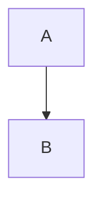

# Code

```rust
fn main() {
    // a comment
    let x: u32 = 42;
    println!("hello {}", x);
}
```

```python
def greet(name):
    """Say hello."""
    return f"hello {name}"  # comment
```

```js
const n = [1, 2, 3].map((x) => x * 2); // double
```


